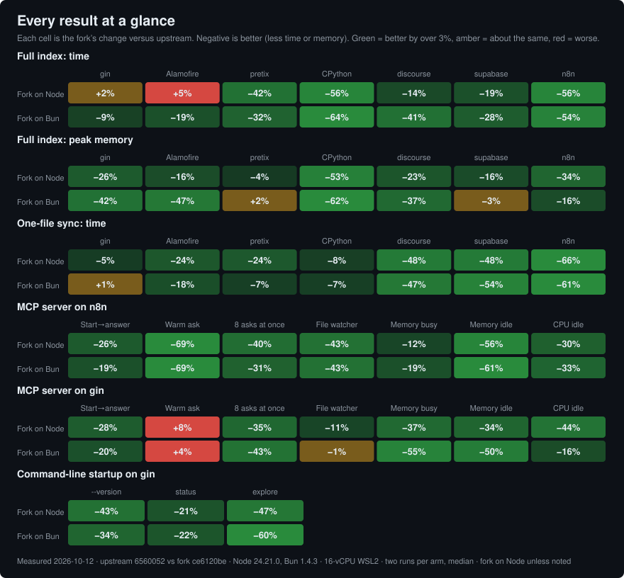

# Fork vs upstream on Node and Bun (2026-10-12)

The measurements behind the README's "Measured results" and "What it costs"
sections. Each build runs on Node.js 24 and on Bun, so one table covers both
the fork-versus-upstream comparison and the runtime comparison. This
supersedes [`fork-vs-upstream-node-bun-2026-10-03.md`](fork-vs-upstream-node-bun-2026-10-03.md),
which measured the same upstream build (`6560052a`) against fork `34cc55e2`
with the same method and corpora. [Since 2026-10-03](#since-2026-10-03)
compares the two runs.

## Method

The scripts are in [`scripts/benchmarks/runtime/`](../../scripts/benchmarks/runtime/): `run-index-sync.sh`, `run-mcp.sh` and `run-cli.sh`, with the four arms below. `render-charts.mjs` turns the raw output into the README chart, the heatmap and the tables on this page.

- **Builds.** Upstream `main` at `6560052a` (release 1.6.2), the same build as
  on 2026-10-03, and fork `fork/consolidated` at `ce6120be`. Each worktree
  ran `npm ci`, built its own native kernel from source, and ran
  `npm run build`.
- **Arms.**

  | Arm | Command |
  |---|---|
  | upstream, Node | `node` 24.21.0 running upstream's `dist/bin/codegraph.js` |
  | fork, Node | `node` 24.21.0 running the fork's `dist/bin/codegraph.js` |
  | fork, Bun | `bun` 1.4.3 running the fork's `dist/bin/codegraph.js` |
  | upstream, Bun | `bun` 1.4.3 running upstream's build, with `CODEGRAPH_ALLOW_UNSAFE_NODE=1` |

  Bun reports a Node.js compatibility version of 26 or newer, and upstream
  refuses Node 25 and newer, so without the override upstream exits with
  `Unsupported Node.js version`. The fork needs no override. The previous run
  used Bun 1.4.2.
- **Host.** WSL2 Ubuntu, 16 vCPUs, 62 GiB RAM, ext4. Each run waited until
  the host was quiet (below), and the benchmark held the host lock while it
  ran.
- **Environment.** `CODEGRAPH_DIR=.cg-bench`, `CODEGRAPH_TELEMETRY=0`, and
  `CODEGRAPH_NO_DAEMON=1` for the CLI runs. Every timed command ran at normal
  priority under `~/.local/bin/run-capped 16G` (a 16 GiB memory cap) and
  `/usr/bin/time -v`. Peak memory is MaxRSS. Database size is `codegraph.db`
  after a WAL checkpoint.
- **Order.** Per corpus the arms ran in the order upstream Node, fork Node,
  fork Bun, upstream Bun, then the reverse. Each run did a full index
  (`codegraph init --yes .` into an empty directory) and then two one-file
  syncs (a one-line edit to the same file, then `codegraph sync .`). Index
  figures are the median of two runs; sync figures are the median of four.
- **Corpora**, pinned to the same commits as on 2026-09-28 and 2026-10-03,
  shallow, no dependencies installed:
  - gin (Go) `1bd0ecf`
  - Alamofire (Swift) `bda9ed5`
  - pretix (Python and JavaScript) `aa14505`
  - CPython (C and Python) `1e8ff18`
  - discourse (Ruby and JavaScript) `ae5ba2c4`
  - supabase (React, Next.js and TypeScript) `36371de1`
  - n8n (Vue and TypeScript) `7cc0450a`

Both runtimes of a build produced the same node and edge counts on every
corpus.

### Quiet-host rule

A run started only when swap in use was at most 64 MiB, the 1-minute load
average was under 2, no `capped-*` scope was running, and Windows CPU, read from
the Windows side, was under 20% for three samples 20 s apart. An attempt was
rejected as suspect when the command exited non-zero or a Windows CPU sample
before or after it exceeded 30%. Each corpus had one retry; the first accepted
attempt is the one reported. The two runs per arm are the spread this page
offers; no wider variation criterion was set before the run, so a difference
near the 3% reporting band is labelled no clear change.

- **n8n index and sync:** attempt 1 was rejected (Windows CPU read 32% before
  it); attempt 2 is reported. The two attempts agreed within about 4% on index time.
- **gin, Alamofire, pretix and CPython** ran under an earlier form of the rule
  that required swap in use to be zero and also rejected an attempt when the
  1-minute load after it exceeded 4. That load figure includes the benchmark's
  own CPU, so the rule was dropped after it rejected both pretix attempts and
  one CPython attempt with Windows CPU readings of 4–17% on both sides. Those
  attempts were re-evaluated under the current rule from the same readings and
  accepted. Pretix's first attempt is reported.
- **Limit.** Other work on the host during a run was observed only by the
  load before the run and by the Windows CPU samples before and after it, not
  continuously.

## Full index

Time and peak memory, median of two.

| Corpus | Upstream, Node | Fork, Node | Fork, Bun | Upstream, Bun |
|---|---|---|---|---|
| gin | 1.13 s, 547 MiB | 1.15 s, 403 MiB | 1.34 s, 302 MiB | 1.48 s, 522 MiB |
| Alamofire | 1.73 s, 837 MiB | 1.81 s, 702 MiB | 1.69 s, 475 MiB | 2.09 s, 894 MiB |
| pretix | 18.8 s, 3.38 GiB | 11.0 s, 3.25 GiB | 11.2 s, 2.55 GiB | 16.4 s, 2.51 GiB |
| CPython | 95.3 s, 8.70 GiB | 41.6 s, 4.13 GiB | 39.1 s, 3.56 GiB | 107.6 s, 9.33 GiB |
| discourse | 26.6 s, 3.74 GiB | 22.7 s, 2.90 GiB | 20.8 s, 2.23 GiB | 35.5 s, 3.52 GiB |
| supabase | 26.0 s, 4.46 GiB | 20.9 s, 3.76 GiB | 21.2 s, 3.65 GiB | 29.4 s, 3.75 GiB |
| n8n | 163.6 s, 9.66 GiB | 71.8 s, 6.38 GiB | 72.9 s, 6.10 GiB | 157.8 s, 7.28 GiB |

Graph size. Node and edge counts are identical across runtimes; database
sizes are from the Node runs:

| Corpus | Upstream nodes / edges / database | Fork nodes / edges / database |
|---|---|---|
| gin | 2,582 / 7,802 / 8.3 MiB | 3,089 / 8,329 / 10.1 MiB |
| Alamofire | 4,600 / 12,507 / 17.1 MiB | 5,614 / 13,673 / 19.2 MiB |
| pretix | 32,322 / 80,949 / 122 MiB | 32,797 / 74,462 / 148 MiB |
| CPython | 167,253 / 620,214 / 494 MiB | 167,929 / 600,467 / 574 MiB |
| discourse | 162,890 / 299,213 / 384 MiB | 167,866 / 299,071 / 429 MiB |
| supabase | 113,457 / 284,976 / 338 MiB | 151,607 / 319,674 / 465 MiB |
| n8n | 310,034 / 1,179,729 / 1.43 GiB | 324,762 / 1,213,274 / 1.68 GiB |

The edge counts differ because the builds resolve differently: the fork adds
Markdown, route and dispatch links, and declines call links it cannot confirm.
The timings compare the cost of building each build's own graph, not the same
graph.

## One-file sync

Median of four syncs.

| Corpus | File | Upstream, Node | Fork, Node | Fork, Bun | Upstream, Bun |
|---|---|---|---|---|---|
| gin | `gin.go` | 0.51 s | 0.48 s | 0.41 s | 0.41 s |
| Alamofire | `Source/Core/Session.swift` | 0.73 s | 0.55 s | 0.48 s | 0.59 s |
| pretix | `src/pretix/base/models/orders.py` | 3.15 s | 2.38 s | 2.38 s | 2.56 s |
| CPython | `Lib/os.py` | 8.54 s | 7.87 s | 7.97 s | 8.56 s |
| discourse | `app/models/user.rb` | 5.83 s | 3.01 s | 2.71 s | 5.09 s |
| supabase | `apps/studio/data/projects/clone-mutation.ts` | 6.12 s | 3.17 s | 2.60 s | 5.61 s |
| n8n | `packages/cli/src/active-executions.ts` | 12.8 s | 4.39 s | 4.12 s | 10.6 s |

## MCP server

The method matches the [2026-09-28 run](fork-vs-upstream-node-bun-2026-09-28.md#mcp-server):
`mcp-bench.mjs` speaks JSON-RPC to `codegraph serve --mcp --path <repo>` over
stdio, with each build's index prebuilt by its own Node arm, two runs per arm
in mirrored order. Each run times 12 warm explores and records the 7th fastest
as its median and the 11th as its p90; the tables show the median of the two
runs. Memory and CPU are summed over the stdio server, the detached daemon it
starts, and their children. Idle CPU is the percentage of one core.

**n8n** (edited `packages/workflow/src/workflow.ts`):

| Measure | Upstream, Node | Fork, Node | Fork, Bun | Upstream, Bun |
|---|---|---|---|---|
| `initialize` answered | 119 ms | 67 ms | 59 ms | 86 ms |
| Start to first explore answer | 4.07 s | 3.00 s | 2.76 s | 3.41 s |
| Warm explore, median | 693 ms | 214 ms | 211 ms | 685 ms |
| Warm explore, p90 | 836 ms | 295 ms | 294 ms | 799 ms |
| 8 concurrent explores | 3.89 s | 2.35 s | 2.43 s | 3.54 s |
| Memory while busy | 4.41 GiB | 3.89 GiB | 3.01 GiB | 3.73 GiB |
| Edited file re-indexed | 1.52 s | 872 ms | 683 ms | 1.19 s |
| Memory at idle | 4.77 GiB | 2.09 GiB | 1.21 GiB | 3.07 GiB |
| CPU at idle | 0.47% | 0.33% | 0.48% | 0.73% |

**gin** (edited `gin.go`):

| Measure | Upstream, Node | Fork, Node | Fork, Bun | Upstream, Bun |
|---|---|---|---|---|
| `initialize` answered | 114 ms | 66 ms | 56 ms | 82 ms |
| Start to first explore answer | 519 ms | 375 ms | 290 ms | 361 ms |
| Warm explore, median | 24 ms | 26 ms | 25 ms | 24 ms |
| Warm explore, p90 | 34 ms | 32 ms | 29 ms | 29 ms |
| 8 concurrent explores | 265 ms | 172 ms | 227 ms | 398 ms |
| Memory while busy | 1.10 GiB | 708 MiB | 426 MiB | 948 MiB |
| Edited file re-indexed | 436 ms | 386 ms | 385 ms | 387 ms |
| Memory at idle | 1.10 GiB | 743 MiB | 449 MiB | 899 MiB |
| CPU at idle | 0.28% | 0.16% | 0.43% | 0.51% |

On gin, a warm explore takes 26 ms on the fork against 24 ms on upstream on
Node, and 25 ms against 24 ms on Bun. Each figure is the median of two runs of
12 explores, so a 1–2 ms difference is close to the timer's noise. It is the
only place a warm explore is slower.

Bun's concurrent explores on gin are slower than the fork on Node (227 ms
against 172 ms) and 3% slower on n8n (2.43 s against 2.35 s), which is inside
the 3% band. Contention between worker threads reading through Bun's SQLite is
the suspected cause, not confirmed
([oven-sh/bun#44187](https://github.com/oven-sh/bun/issues/44187)). Bun's idle
CPU is 1.4 to 2.7 times Node's, still under 1% of one core.

## CLI startup

`hyperfine -N --warmup 3 --runs 20` on gin with a prebuilt index and
`CODEGRAPH_NO_DAEMON=1`, mean ± standard deviation:

| Command | Upstream, Node | Fork, Node | Fork, Bun | Upstream, Bun |
|---|---|---|---|---|
| `codegraph --version` | 68 ± 4 ms | 39 ± 2 ms | 30 ± 1 ms | 46 ± 2 ms |
| `codegraph status .` | 183 ± 10 ms | 144 ± 10 ms | 97 ± 5 ms | 125 ± 6 ms |
| `codegraph explore '<query>'` | 243 ± 14 ms | 130 ± 6 ms | 101 ± 3 ms | 256 ± 37 ms |

## Every result at a glance

Each cell is the fork's change against upstream on the same runtime (Node
against Node, Bun against Bun). Green is better by more than 3%, amber is
within 3%, red is worse. Of the 76 comparisons, the fork is better in 68,
about the same in 5, and worse in 3: indexing Alamofire on Node (+5%, with
overlapping runs) and the warm explore on gin on Node (+8%) and on Bun (+4%).

## Since 2026-10-03

Full index time on Node, upstream `6560052a` in both runs:

| Corpus | Upstream, 2026-10-03 | Upstream, 2026-10-12 | Fork `34cc55e2` | Fork `ce6120be` | Fork as a share of upstream, then and now |
|---|---|---|---|---|---|
| gin | 1.03 s | 1.13 s | 1.17 s | 1.15 s | 114% → 102% |
| Alamofire | 1.62 s | 1.73 s | 2.05 s | 1.81 s | 127% → 105% |
| pretix | 21.1 s | 18.8 s | 10.8 s | 11.0 s | 51% → 58% |
| CPython | 94.7 s | 95.3 s | 45.5 s | 41.6 s | 48% → 44% |
| discourse | 23.7 s | 26.6 s | 25.1 s | 22.7 s | 106% → 86% |
| supabase | 26.7 s | 26.0 s | 23.1 s | 20.9 s | 87% → 81% |
| n8n | 168.9 s | 163.6 s | 78.4 s | 71.8 s | 46% → 44% |

Upstream is the same build in both runs, so its change between runs (from 11%
faster to 12% slower) is the spread of the host and the method, and the
fork's own change since 2026-10-03 should be read against that spread. The
last column is the steadier comparison. It shows the earlier losses on gin,
Alamofire and discourse gone or inside the band. pretix moved the other way,
from 51% to 58% of upstream's time (the fork 10.8 s to 11.0 s, upstream 11%
faster this time); that difference is inside the spread above.

Between `34cc55e2` and `ce6120be` the fork gained 245 commits, among them
upstream merges and #477, which changed how a small project's references are
resolved (a project under about 15,000 references looks nodes up by query, and
a minified one-line file's text is no longer walked from its start for every
reference in it). This run did not measure each change on its own.

The fork's pretix graph has 74,462 edges against 77,554 on 2026-10-03; its
CPython graph has 600,467 against 599,991. The cause of the pretix change was
not investigated.

## Test suite

The full suite on the #477 branch, which became `ce6120be`, passed on
Node.js 24.21.0: 696 test files, 8,905 tests passed and 39 skipped. It was not
re-run on Node.js 26 or Bun for this measurement; the last passes on
Node.js 26.10.0 and Bun 1.4.2 were at `48903f51`, in the
[2026-09-28 run](fork-vs-upstream-node-bun-2026-09-28.md#test-suite).
