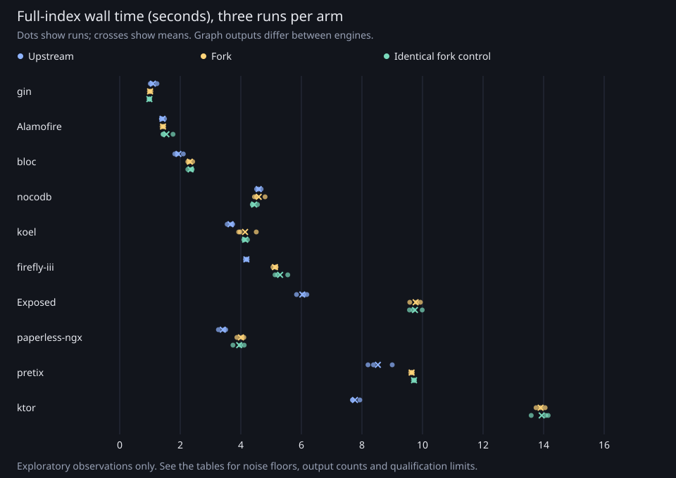

# Mid-size full-index comparison, 2026-10-15

The fork had no clear wall-time change on four of ten corpora and longer wall times outside the declared variation range on six. All ten produced different graphs between engines, so these observations do not establish an equivalent-work speedup or regression.

This reruns the [historical mid-size sweep](fork-vs-upstream-node-bun-2026-10-12.md#mid-size-projects-and-the-resolver-pool) after #488, #489 and #506. It measures the fork at `f405d86bbad6f3299f4fbea77663dfc445d2ab4b` against upstream at `c71a3d0373fba27b597f3bfa1d58bcb4e116be1e`, both on Node 24.22.0. It does not isolate the contribution of any one fix or compare against the old fork build.

## Method and qualification limits

There are 90 accepted full-index runs, three per arm per corpus. Arm U is upstream, F is the fork and A uses the exact same fork executable as F. Each round uses U/F/A, F/A/U and A/U/F respectively, visiting the ten corpora in table order. Every run starts a new `codegraph init --yes .` process and a fresh index directory. Build time, admission, output hashing and index deletion are outside the child timing; process startup and indexing are inside it. Filesystem caches were not flushed. These are fresh indexes, not cold-cache measurements.

The six identical-build F+A wall times supply each corpus's noise floor, `max(F+A) - min(F+A)`, in seconds. The fork/upstream median gap must exceed it and their three-run ranges must be disjoint. Otherwise the result is **no clear change**. This fixed exploratory survey stops at three accepted runs per arm; it adds no confirmation runs. No significance test or minimum percentage gain is used.

The 16-vCPU WSL2 host ran measured children at normal priority with all 16 CPUs available, under a 16 GiB memory cap and the shared benchmark lock. Builds ran sequentially at nice 10 under 6 GiB. Before each child, admission required load1 below 2, fewer than two busy cores over three seconds, at least 8 GiB available RAM and at most 64 MiB swap in use. Adjacent Linux counters rejected estimated foreign CPU above two average cores after subtracting child CPU. Any swap-in/out, full memory PSI above 250 ms or swap use above 64 MiB also rejected a run.

Four attempts were rejected for estimated foreign CPU above two cores. Initially one replacement was allowed; after bloc exhausted both attempts, the retry limit was prospectively increased to four total attempts per arm/round. All six then-accepted runs and both rejected attempts were retained. The completed archive has 94 attempts, 90 accepted and four rejected. Every indexing command itself exited 0.

Qualification remains incomplete. Native Windows load was not observed, cgroup counters were not fully collected and observer sensitivity was not calibrated. The host CPU subtraction is an estimate, not process-level attribution of the interfering job. Source revisions and tracked corpus changes were checked on resume, but executable artifact hashes were not frozen prospectively. These results are exploratory and apply to this host, these inputs and these builds. They do not cover Bun, macOS, smaller hosts or one-file sync.

Graph counts and normalized SHA-256 hashes were stable across all three repetitions of each engine and all six fork/control runs. The hash includes all node columns except `updated_at`, all edge columns except generated `id`, and unresolved-reference status counts in deterministic order. This is not byte-identical database validation or a hash of every unresolved-reference row. Fork and upstream outputs differ on every corpus, so timing differences may include different work and graph coverage.

The [machine-readable records](midsize-sweep-2026-10-15.json) contain all 94 attempts, source/corpus identities, timing, output hashes and raw Linux counter boundaries. Full process stdout/stderr and time receipts are retained in the local measurement archive. The tables below were recomputed from the accepted records and their rejection classifications checked against raw counters and time receipts.

## Wall time

Each engine cell is the median (minimum-maximum), in seconds, of three accepted runs. F+A range covers six runs. Positive wall change means the fork took longer. Percentages inside the declared variation criterion are labeled no clear change.

| Corpus | Upstream, s | Fork, s | Identical fork control, s | F+A range, s | Fork wall change | Range observation |
| --- | ---: | ---: | ---: | ---: | --- | --- |
| gin | 1.05 (1.01-1.23) | 1.00 (0.98-1.03) | 0.98 (0.97-0.99) | 0.06 | no clear change | no clear change |
| Alamofire | 1.38 (1.38-1.48) | 1.44 (1.40-1.45) | 1.44 (1.43-1.76) | 0.36 | no clear change | no clear change |
| bloc | 1.90 (1.82-2.10) | 2.29 (2.25-2.41) | 2.38 (2.25-2.39) | 0.16 | +20.5% longer | fork longer; unequal output |
| nocodb | 4.58 (4.52-4.67) | 4.52 (4.45-4.80) | 4.39 (4.38-4.55) | 0.42 | no clear change | no clear change |
| koel | 3.70 (3.55-3.73) | 3.98 (3.93-4.51) | 4.11 (4.10-4.22) | 0.58 | no clear change | no clear change |
| firefly-iii | 4.19 (4.15-4.21) | 5.16 (5.06-5.16) | 5.21 (5.13-5.55) | 0.49 | +23.2% longer | fork longer; unequal output |
| Exposed | 6.07 (5.84-6.18) | 9.81 (9.58-9.93) | 9.69 (9.57-9.99) | 0.42 | +61.6% longer | fork longer; unequal output |
| paperless-ngx | 3.45 (3.26-3.50) | 4.04 (3.87-4.10) | 3.99 (3.74-4.11) | 0.37 | +17.1% longer | fork longer; unequal output |
| pretix | 8.38 (8.20-9.00) | 9.65 (9.61-9.66) | 9.73 (9.70-9.73) | 0.12 | +15.2% longer | fork longer; unequal output |
| ktor | 7.69 (7.69-7.93) | 13.90 (13.75-14.05) | 14.07 (13.59-14.15) | 0.56 | +80.8% longer | fork longer; unequal output |

Ktor fills the previously unmeasured 111,000-150,000-reference interval with 144,028 processed references in the fork survey. Its repeated median wall time was 13.90 s for the fork and 7.69 s upstream. Exposed was 9.81 s and 6.07 s respectively. These are current observations, not a controlled before/after estimate for #488, #489 or #506.

## CPU and peak memory

CPU is user plus system seconds; peak RSS is whole-process resident memory in MiB. Each cell is a three-run median (minimum-maximum). RSS change compares medians descriptively; the wall-time noise rule does not qualify memory or CPU differences.

| Corpus | Upstream CPU, s | Fork CPU, s | Upstream peak RSS, MiB | Fork peak RSS, MiB | Fork RSS change |
| --- | ---: | ---: | ---: | ---: | ---: |
| gin | 2.26 (2.18-2.81) | 1.57 (1.54-1.63) | 570.75 (549.81-577.43) | 402.02 (371.27-402.58) | -29.6% |
| Alamofire | 5.25 (5.25-5.43) | 4.89 (4.84-5.08) | 791.08 (790.12-853.30) | 1042.12 (1011.00-1063.61) | +31.7% |
| bloc | 7.10 (6.85-7.11) | 6.92 (6.85-7.36) | 1056.87 (1038.64-1068.06) | 1059.75 (1054.94-1068.61) | +0.3% |
| nocodb | 18.08 (17.43-18.55) | 14.95 (14.86-15.74) | 1988.07 (1940.30-1990.30) | 1663.14 (1656.54-1736.94) | -16.3% |
| koel | 14.50 (14.32-14.62) | 12.26 (12.03-13.28) | 1497.72 (1486.95-1543.97) | 1472.86 (1461.75-1516.31) | -1.7% |
| firefly-iii | 15.49 (15.38-15.92) | 15.56 (15.53-15.59) | 1922.62 (1908.88-1988.17) | 2085.32 (2080.80-2104.93) | +8.5% |
| Exposed | 21.10 (20.64-21.55) | 36.55 (35.64-36.63) | 2130.29 (2113.68-2143.80) | 2496.49 (2482.41-2496.96) | +17.2% |
| paperless-ngx | 13.17 (13.12-13.85) | 13.02 (12.39-13.14) | 1698.29 (1667.16-1786.53) | 1626.46 (1569.04-1636.28) | -4.2% |
| pretix | 33.79 (33.43-35.66) | 33.15 (32.94-33.31) | 3008.72 (3006.11-3020.81) | 3514.11 (3422.97-3571.40) | +16.8% |
| ktor | 31.13 (30.81-31.94) | 53.08 (52.64-53.48) | 2662.18 (2652.66-2732.95) | 2506.00 (2505.51-2551.64) | -5.9% |

## Output counts and inputs

The third count is stored unresolved-reference rows, including their recorded resolution states. It is not the number still pending after resolution, nor the processed-reference total summed from timing batches. Corpus SHAs and normalized graph hashes are in the machine-readable archive; tracked diffs were empty for every corpus.

| Corpus | Upstream nodes / edges / reference rows | Fork nodes / edges / reference rows |
| --- | --- | --- |
| gin | 2582 / 7705 / 9037 | 3089 / 8329 / 9193 |
| Alamofire | 4600 / 12507 / 14670 | 5614 / 13673 / 14875 |
| bloc | 6691 / 17875 / 20487 | 17501 / 29384 / 23992 |
| nocodb | 24420 / 52347 / 58528 | 24570 / 48763 / 62286 |
| koel | 26763 / 55994 / 54786 | 27687 / 56527 / 55358 |
| firefly-iii | 24798 / 52304 / 76390 | 25473 / 51865 / 77516 |
| Exposed | 26950 / 87764 / 50025 | 28689 / 82842 / 57656 |
| paperless-ngx | 20799 / 44267 / 79201 | 23035 / 45904 / 80371 |
| pretix | 32781 / 78004 / 162650 | 32797 / 74462 / 166213 |
| ktor | 47312 / 120022 / 71572 | 49708 / 112139 / 82625 |

The exploratory size survey processed 269,906 references for django, 170,549 for halo and 459,348 for trezor-suite. It processed 144,028 for Ktor, 1,860,188 for n8n and 418,359 for discourse. Ktor was the first candidate in the declared interval. Survey timings do not enter the repeated comparison.

## Historical statistical caveat

The 2026-10-12 sweep predeclared a median permutation test with p below 0.05. At four runs per arm its minimum attainable p-value was 0.057, so no cell could qualify as CLEAR under that rule. Its disjoint-range interpretation was post hoc. The new prospective range rule does not retroactively qualify those historical cells, and the different builds, reference totals and controls prevent attributing a cross-date change to one fix.
